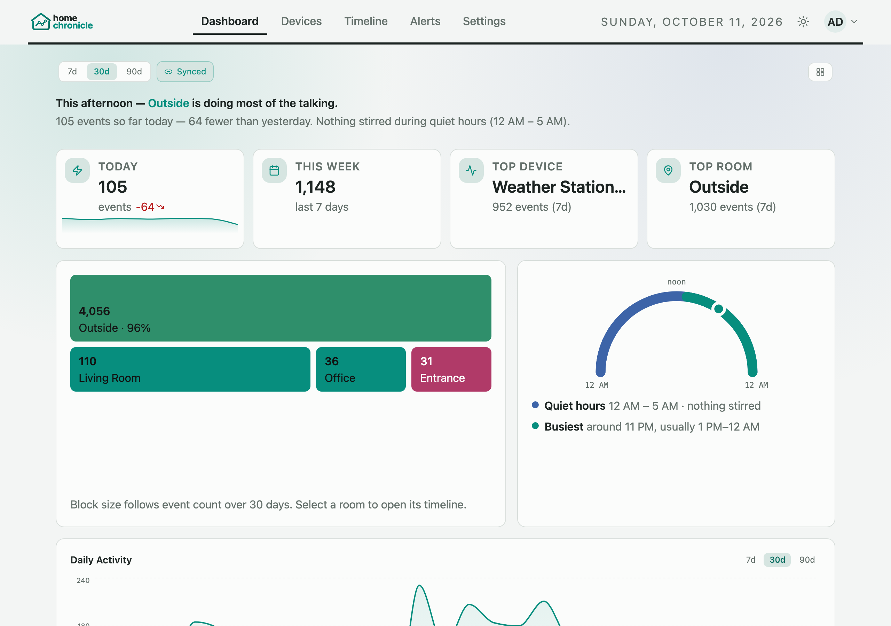

# homechronicle

[](https://gitlab.com/havuq/homechronicle/-/releases)   

 


homechronicle is a self-hosted event log for Apple HomeKit and Matter devices.
It shows what happened in your home over time, not just the current state.



## What You Get

- Timeline of HomeKit and Matter activity (what changed and when)
- Easy setup from the web app (no terminal pairing flow)
- Filter by room, device, and date
- A customizable dashboard: house summary, room map, today's rhythm, trends, and heatmaps
- Webhook and email alert rules
- Twelve colour palettes, each with a light and dark version
- Optional multi-user sign-in
- Works with Homebridge bridges and child devices
- Runs 24/7 with Docker

## Quick Start

The fastest way to get running — one command, everything included:

```bash
docker run -d \
  --name homechronicle \
  --network host \
  -e WEB_PORT=3000 \
  -v hc-db:/var/lib/postgresql/data \
  -v hc-data:/app/listener/data \
  -v /run/dbus/system_bus_socket:/run/dbus/system_bus_socket:ro \
  havuq/homechronicle-standalone
```

Open `http://localhost:3000` (or `http://<your-server-ip>:3000` from another device).

> **Bridge mode:** If you don't need HomeKit/Matter discovery, you can use `-p 3000:80` instead of `--network host`. See the [Standalone Docker docs](https://homechronicle.net/guide/#/standalone) for details.

### Docker Compose (alternative)

For more control (separate containers, external PostgreSQL access, per-service resource limits):

```bash
git clone https://gitlab.com/havuq/homechronicle.git
cd homechronicle
cp .env.example .env
# Set POSTGRES_PASSWORD and API_TOKEN in .env
docker compose up -d
```

For a complete list of available settings:
- Environment variables: [docs/environment-variables.md](docs/environment-variables.md)
- Minimal compose example: [docs/docker-compose.example.yml](docs/docker-compose.example.yml)
- Portainer stack example (`docker-compose.portainer.yml`): [docs/portainer.md](docs/portainer.md)
- **On a Mac?** Docker there can't discover HomeKit accessories; run the listener natively: [docs/guide/macos.md](docs/guide/macos.md)

### Pair your HomeKit devices

1. Open **Devices › Add Accessories** in the app.
2. Click **Scan Network** in the HomeKit section.
3. Enter the device PIN (`111-22-333` format) and click **Pair**.

Events will begin showing in the Timeline once pairing succeeds. A device that's already in Apple Home needs an extra step — see [Device Setup](https://homechronicle.net/guide/#/devices).

## Daily Use

**Standalone:**
- `docker logs -f homechronicle` to view logs
- `docker restart homechronicle` if you need to reconnect device subscriptions

**Docker Compose:**
- `docker compose ps` to check containers
- `docker compose logs -f listener web postgres` to view logs
- `docker compose restart listener` if you need to reconnect device subscriptions

## Matter

Matter works out of the box — the listener uses matter.js to commission devices and subscribe to them, so changes arrive as they happen (with a background re-read every 5 minutes as a safety net). Readings use the same names and units as HomeKit.

### Adding a Matter Device

If your Matter accessory is already in Apple Home, you can add it to homechronicle:

1. In Apple Home, open the accessory, tap the gear icon, and choose **Turn On Pairing Mode** to get a setup code.
2. In homechronicle, open **Devices › Add Accessories** and click **Scan Network** in the Matter section (or use **Add manually…**).
3. Enter a name and the setup code, then click **Pair**. Commissioning can take a few minutes.

> **VLAN users:** Matter requires IPv6 link-local connectivity between the Docker host and your devices. If your IoT devices are on a separate VLAN, you need a VLAN sub-interface on the host. See the [Networking guide](https://homechronicle.net/guide/#/networking) for VLAN configuration.

## Alerts

homechronicle can send a webhook or an email when device events — HomeKit or Matter — match rules you define.

### Creating Alert Rules

1. Open the **Alerts** page.
2. Fill in the **Alert Rules** form:
   - **Name** — a label for this rule
   - **Webhook** or **Email** — where to deliver it (email needs SMTP configured)
   - **Scope** — all events, a room, an accessory, or a characteristic
   - **Characteristic filter** — optionally narrow to one characteristic (e.g. `On`, `CurrentTemperature`)
   - **Condition** — equals / not equals / contains + a match value
   - **Quiet period** — minutes to suppress repeat alerts after one fires
3. Click **Create Rule**. Rules are enabled per rule and can be switched off at any time.

### Delivery History

**Recent Deliveries** on the Alerts page shows each delivery with `sent`, `suppressed`, or `failed` status. Delivery history retention is controlled by the `ALERT_RETENTION_DAYS` environment variable (default 90 days). See the [Alerts guide](https://homechronicle.net/guide/#/alerts) for details.

For a full list of alert-related environment variables, see [docs/environment-variables.md](docs/environment-variables.md).

## Update homechronicle

Back up first, and read the [upgrade notes](https://homechronicle.net/guide/#/upgrading) — database migrations run automatically when the listener starts.

**Standalone:**
```bash
docker pull havuq/homechronicle-standalone:latest
docker stop homechronicle && docker rm homechronicle
# Re-run your original docker run command
```

**Docker Compose:**
```bash
git pull
docker compose pull
docker compose up -d
```

## Documentation

Full documentation is available at [homechronicle.net/guide](https://homechronicle.net/guide/).

## Troubleshooting

See the [Troubleshooting guide](https://homechronicle.net/guide/#/troubleshooting) for common issues and fixes.

## License

[AGPL-3.0](LICENSE)
