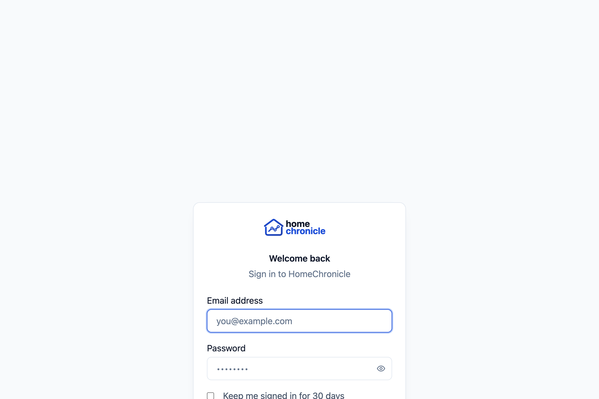
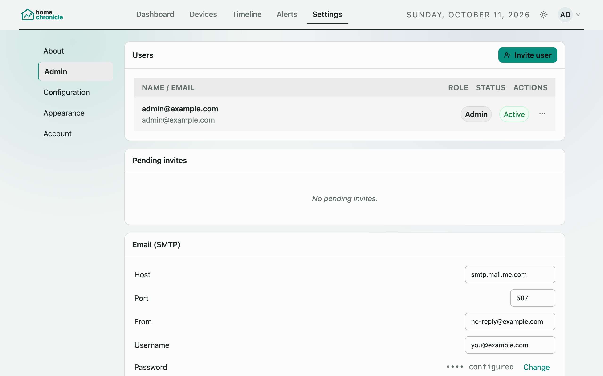
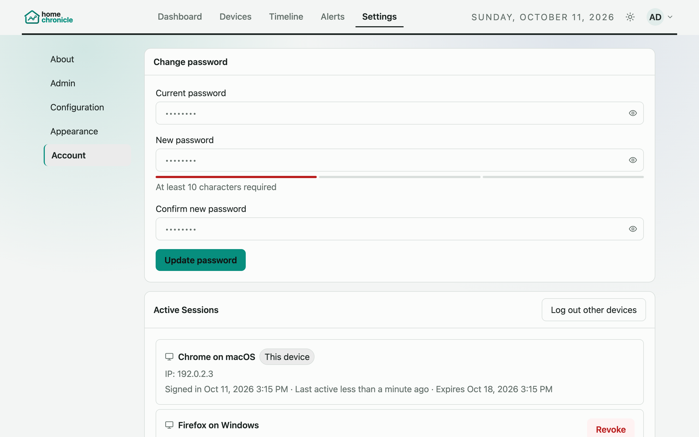

# Accounts & Users

Login is **optional**. By default `AUTH_ENABLED=true` activates the multi-user session system. Set `AUTH_ENABLED=false` to disable it entirely — the app reverts to the single-operator mode gated only by `API_TOKEN` (the v1.3 behavior). No user or session data is created in that case.

## First-Run Admin Claim

When auth is on and no admin account exists, the first visit to the app presents a one-time setup screen to create the admin account (`POST /claim-admin`). This step is race-safe and can only succeed once. All subsequent accounts are invite-only — there is no public registration.

## Sessions & Passwords

- Browser auth uses a DB-backed session stored in an HttpOnly cookie (`hc_session`).
- Passwords are hashed with **argon2id**.
- **Remember me** at login extends the session lifetime:
  - Default: `SESSION_MAX_AGE_DEFAULT` (7 days — 604 800 000 ms)
  - Remember me: `SESSION_MAX_AGE_REMEMBER` (30 days — 2 592 000 000 ms)
- Set `SESSION_COOKIE_SECURE=true` on HTTPS deployments so the cookie is only transmitted over encrypted connections. Leave it at the default (`false`) for plain HTTP on a home LAN.

See [Security](security.md) for the session auth model and CSRF protection details, and [Environment Variables](environment-variables.md) for all auth/session variables.

## User Management

Only admins can manage users. From **Settings > Admin > Users**:

| Action | Notes |
|--------|-------|
| **Invite member** | Sends an email with a signup link. The invite doubles as email verification. |
| **Change role** | Promote a member to admin or demote an admin to member. A last-admin guard prevents demoting/disabling the only admin. |
| **Disable account** | Prevents login without deleting the account. |

Roles are `admin` and `member`. Email must be configured before invites or password resets work — see [Email (SMTP)](email.md).

Password reset is email-based: a signed-in user can request a reset from **Settings > Account**, and the link is sent to their account email.

## Members vs. Admins

| Capability | Admin | Member |
|------------|-------|--------|
| View events, timeline, analytics | Yes | Yes |
| Create/own alert rules (webhook or email) | Yes | Yes |
| Set email alert recipient | Any address | Own account email only |
| Settings > Configuration (device, data, timeline) | Yes | Yes |
| Appearance, toast, per-user preferences | Yes | Yes |
| SMTP configuration (Settings > Admin) | Yes | No |
| User management (Settings > Admin) | Yes | No |
| Danger Zone (delete devices / wipe data) | Yes | No |
| Log level adjustment | Yes | No |

For alert rule behavior and the email recipient constraint see [Settings](settings.md#alerts).

## Active Sessions

Each user can view their own active sessions — including the browser/device user agent and IP address captured at login — under **Settings > Account > Active Sessions**. Sessions can be revoked individually. Revoke is owner-only; admins cannot revoke other users' sessions.

## Household Model

All accounts share the same event data. HomeChronicle is a household system — accounts provide access control and audit, not per-user data isolation. Every user sees the same device list, timeline, and analytics.

**Per-user preferences** (theme, accent, dashboard layout, toast settings, sidebar state, dashboard range, quiet-hours config) are saved per account and synced across your devices when you are signed in. See [Settings](settings.md) for details.
