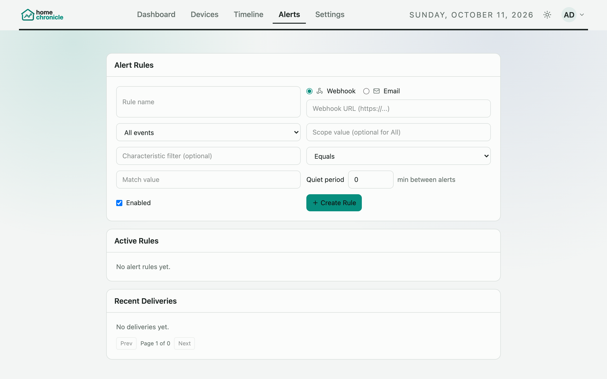

# Alerts

Alert rules notify you when a device event matches a condition — a door opening, motion in the garage, a temperature reading. Each rule sends to a **webhook** (an HTTP POST to a URL you choose) or an **email** address. Rules work for HomeKit and Matter devices alike.



The **Alerts** page has three cards:

| Card | Contains |
|------|----------|
| **Alert Rules** | The form for creating or editing a rule |
| **Active Rules** | Your rules, each with an Enabled/Disabled toggle, **Edit** and **Delete** |
| **Recent Deliveries** | Recent attempts: status, rule, when, and where it was sent |

## Creating a rule

| Field | Description |
|-------|-------------|
| **Rule name** | A name for the rule (up to 200 characters) |
| **Delivery channel** | **Webhook** or **Email**. Email is greyed out until [SMTP](email.md) is configured. |
| **Webhook URL** | `http://` or `https://` URL to POST to. When editing, leave it blank to keep the current URL. |
| **Recipient email address** | Where email alerts go. Members can only send to their own account email (the field is locked); admins can enter any address. |
| **Scope type** + **Scope value** | Which events the rule looks at — see below |
| **Characteristic filter** | Optional. Only match events for this characteristic, such as `MotionDetected`. |
| **Match operator** + **Match value** | The condition on the event's new value — see below |
| **Quiet period** | Minutes to wait after an alert before this rule sends again (0–10080; 0 = no wait) |
| **Enabled** | Whether the rule is active |

### Scope

| Scope type | Scope value | Matches |
|------------|-------------|---------|
| **All events** | (none) | Every event |
| **Room** | Room name | Events from devices in that room |
| **Accessory** | Device name or ID | Events from that device |
| **Characteristic** | Characteristic name | Events for that characteristic, from any device |

Scope values and the characteristic filter are not case-sensitive.

### Match operator

The operator is compared against the event's new value, as recorded in the event log:

| Operator | Matches when the new value… |
|----------|-----------------------------|
| **Equals** | is exactly the match value (case-sensitive) |
| **Not equals** | is anything other than the match value |
| **Contains** | contains the match value (not case-sensitive) |

Values are stored as the device reports them, for example `1` or `true` for motion and on/off, or `23.5` for a temperature. Check a recent event for the device on the [Timeline](timeline.md) or with `GET /api/events` to see the exact form before writing a rule.

## Quiet period

After a rule sends an alert, further matches within its quiet period are not sent. They're recorded in Recent Deliveries as **suppressed** (at most one suppressed entry per quiet period, so a chatty sensor doesn't flood the list). If a delivery **fails**, the rule waits at least 60 seconds before trying again even when its quiet period is 0 (`ALERTS_FAILURE_BACKOFF_MS`).

The per-rule quiet period is not the same as the dashboard's **quiet hours** window (Settings › Configuration › Data management). Quiet hours only flag activity on the dashboard and Timeline; they don't stop or trigger alerts.

## Delivery history

**Recent Deliveries** lists each attempt with its status:

| Status | Meaning |
|--------|---------|
| **sent** | The webhook answered with a success code, or the email was handed to the SMTP server |
| **failed** | The request failed, timed out, got an error response, or the target was blocked — see the error on the entry |
| **suppressed** | Not sent because the rule's quiet period hadn't passed |

Email entries show the recipient. Webhook URLs are never returned by the API, because they often contain secrets.

## Who sees which rules

With login enabled, each rule belongs to the user who created it:

- You see and manage only your own rules and your own deliveries.
- Admins can list every user's rules over the API with `GET /api/alerts/rules?scope=all`, and can delete any rule.
- Rules owned by a disabled user stop firing.

With login disabled, there is one household list and everyone sees every rule.

Each rule is turned on or off on its own; there's no household-wide alerts switch. (`PATCH /api/setup/alerts` rejects an `enabled` field.)

## Limits

| Limit | Default | Variable |
|-------|---------|----------|
| Rules per user | 25 | `ALERTS_MAX_RULES_PER_USER` |
| Rules in total | 100 | `ALERTS_MAX_RULES_TOTAL` |
| Text fields (name, scope value, characteristic, match value) | 200 characters | — |
| Webhook timeout | 5000 ms | **Settings › Configuration › Data management**, or `ALERTS_WEBHOOK_TIMEOUT_MS` (which wins when set) |

Creating a rule beyond a cap fails with an error. Deliveries are also sent through a small concurrency pool (`ALERTS_FANOUT_CONCURRENCY`, `ALERTS_MAX_INFLIGHT`), so a burst of events can't overwhelm the listener. See [Environment Variables](environment-variables.md).

## Webhooks

A webhook is a `POST` with a JSON body:

```json
{
  "type": "homechronicle.alert",
  "firedAt": "2026-10-11T07:42:10.123Z",
  "rule": {
    "id": 3,
    "name": "Garage door opened",
    "scopeType": "accessory",
    "scopeValue": "Garage Door",
    "characteristic": "CurrentDoorState",
    "operator": "equals",
    "matchValue": "0",
    "quietMinutes": 10,
    "targetUrl": "https://hooks.example.com/abc123"
  },
  "event": {
    "id": 128734,
    "timestamp": "2026-10-11T07:42:10.000Z",
    "accessoryId": "AA:BB:CC:DD:EE:FF",
    "accessoryName": "Garage Door",
    "roomName": "Garage",
    "serviceType": "GarageDoorOpener",
    "characteristic": "CurrentDoorState",
    "oldValue": "1",
    "newValue": "0",
    "rawIid": 10
  }
}
```

Any 2xx response counts as sent.

### Target restrictions

To stop rules being used to reach places they shouldn't, the listener checks every webhook URL when the rule is saved and again — after resolving the hostname — each time it sends:

- Only `http` and `https` are allowed.
- `localhost`, loopback (`127.0.0.0/8`, `::1`), link-local (`169.254.0.0/16`, `fe80::/10`), unspecified, multicast and reserved addresses are always blocked, including IPv4 addresses written in IPv6 form.
- Private addresses (`10.0.0.0/8`, `172.16.0.0/12`, `192.168.0.0/16`, `100.64.0.0/10`, IPv6 `fc00::/7`) are allowed by default, so you can alert a home-automation server on your network. Set `ALERTS_ALLOW_PRIVATE_TARGETS=false` to block them.
- Redirects are not followed.

See [Security](security.md) for more.

## Email alerts

Email rules need SMTP configured in **Settings › Admin › Email (SMTP)** — see [Email (SMTP)](email.md). Alert emails use the HomeChronicle email layout, with the rule and event details.
