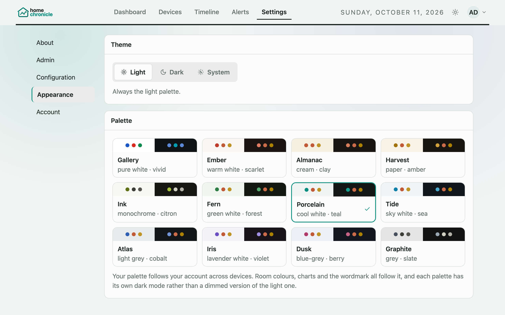

# Appearance

homechronicle has two appearance settings: a **theme** (light, dark, or follow your system) and a **palette** (one of twelve colour schemes). Both live in **Settings › Appearance** and apply immediately — there is no save button and no reload.

## Theme

| Mode | Behavior |
|------|----------|
| **Light** | Always the light version of your palette |
| **Dark** | Always the dark version of your palette |
| **System** | Follows your device's light/dark setting and switches live when it changes (default) |

On desktop (1024 px and wider), the theme button in the top navigation bar cycles **System → Light → Dark**. Its icon shows the current mode: half sun/half moon (system), sun (light), or moon (dark).

On phones and tablets there is no theme button in the floating navigation — change the theme in **Settings › Appearance**.

## Palettes

A palette sets the whole colour scheme: page background, cards, text, accent colour, charts and room colours. Each palette has its own designed dark version rather than a dimmed copy of the light one.

| Palette | Character |
|---------|-----------|
| **Gallery** | pure white · vivid |
| **Ember** | warm white · scarlet |
| **Almanac** | cream · clay |
| **Harvest** | paper · amber |
| **Ink** | monochrome · citron |
| **Fern** | green white · forest |
| **Porcelain** | cool white · teal (default) |
| **Tide** | sky white · sea |
| **Atlas** | light grey · cobalt |
| **Iris** | lavender white · violet |
| **Dusk** | blue-grey · berry |
| **Graphite** | grey · slate |

Each palette card in Settings shows its light and dark halves side by side, so you can judge both at once.

## Room colours

Rooms get their colour from the active palette's nine-colour set. Except in Ink and Graphite, which use near-greyscale room colours on purpose, these sets are checked to stay distinguishable for colour-blind users, in both light and dark mode.

- A room keeps the same colour everywhere — dashboard, Timeline, Devices — and across every filter and date range. The colour is worked out from the room's name, not from how busy it is.
- Because the colour comes from the name, two rooms can end up with the same colour, even if you have only a few rooms.
- The room name is always shown next to its colour, so colour is never the only cue.

You don't pick room colours yourself; changing the palette re-colours every room.

## Where your choice is stored

| Situation | Where it's saved |
|-----------|------------------|
| Signed in (`AUTH_ENABLED=true`) | Your account. Theme and palette follow you to every browser and device you sign in on. |
| Login disabled (`AUTH_ENABLED=false`) | This browser's `localStorage` only. Each browser keeps its own choice. |

Browser keys:

| Key | Values |
|-----|--------|
| `hc_theme_preference` | `system` (default), `light`, `dark` |
| `hc_palette` | `gallery`, `ember`, `almanac`, `harvest`, `ink`, `fern`, `porcelain` (default), `tide`, `atlas`, `iris`, `dusk`, `graphite` |

Clearing site data resets this browser to System and Porcelain (when signed in, your account's choice is restored on the next load).

## Upgrading from an earlier version

Before 0.4 there were eight accent colours instead of palettes. Your old choice is mapped to the nearest palette automatically, the first time 0.4 loads:

| Old accent | New palette |
|------------|-------------|
| Ocean | Tide |
| Graphite | Graphite |
| Sunrise | Harvest |
| Red | Ember |
| Yellow | Harvest |
| Purple | Iris |
| Slate | Atlas |
| Pink | Dusk |

The old browser keys `hc_accent` and `hc_ui_skin` are read once for this mapping. With sign-in enabled, the accent saved on your account is mapped too, so the upgrade also applies on a new device or after you sign out and back in.

See [Upgrading to 0.4](upgrading.md) for the other changes in this release.
