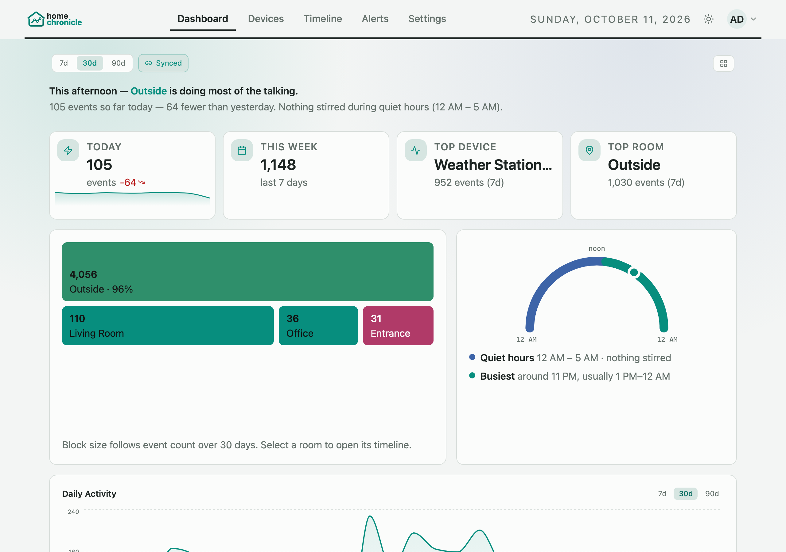
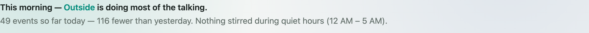
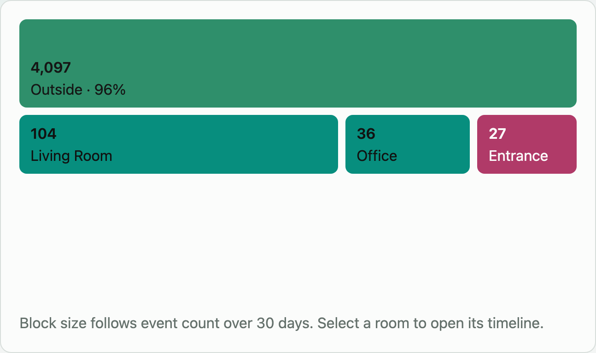
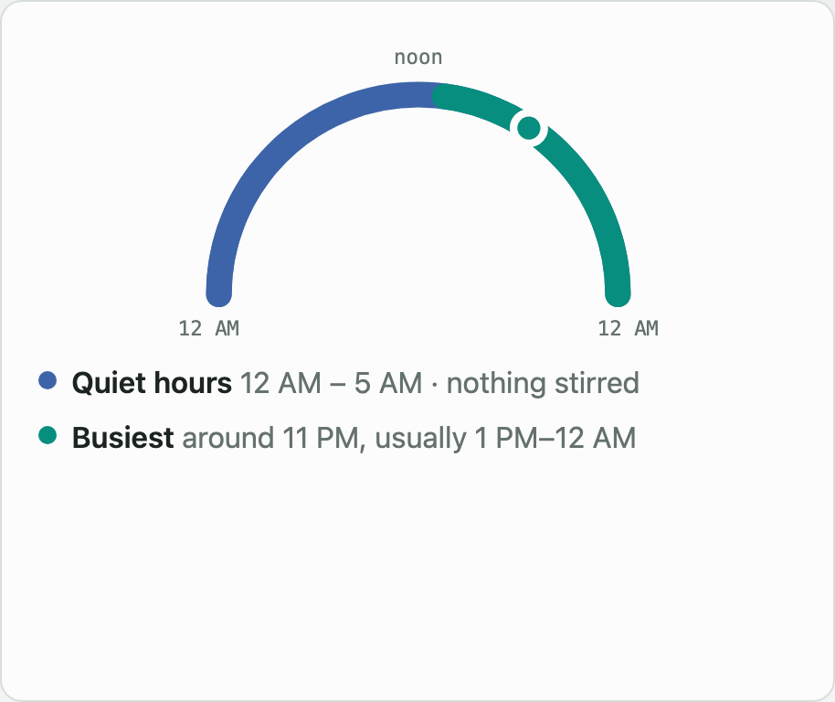

# Dashboard & Analytics

The Dashboard gives you an at-a-glance view of your home's activity. It opens with a one-line summary of the day, then the headline numbers, where and when things happen, trends, devices, and outliers.

## Controls

The bar above the panels has:

| Control | What it does |
|---------|--------------|
| **7d / 30d / 90d** | Date range for the range-aware panels (Daily Activity, Events by Room, Most Active Devices, Weekly Pattern) |
| **Sync** | When on, every range-aware chart follows the range above. When off, each chart keeps its own range. |
| **Customize dashboard** (icon button, right) | Enters edit mode |

## Customizing the layout

Click **Customize dashboard** to enter edit mode. While editing:

- **Drag** a panel by its header to move it
- **Drag the bottom-right corner** of a panel to resize it (desktop and tablet only)
- **Click ✕** on a panel to hide it

Hidden panels collect in a **Hidden panels** tray above the grid. Click a panel's **+** chip to bring it back. Click **Done** to leave edit mode, or **Reset** to restore the default layout and panel set (you'll be asked to confirm).

Changes save automatically. When you're signed in, the layout, panel sizes and hidden panels are saved to your account and follow you across browsers; otherwise they're kept in this browser. Below 768 px the grid becomes a single column and resizing is turned off.

## Default panels

These 15 panels are shown out of the box, in this order.

| Panel | Description |
|-------|-------------|
| **House Summary** | One line about today — see [below](#house-summary) |
| **Overview** | KPI cards: events today, this week, top device, and top room |
| **Where Things Happen** | Room map — see [below](#where-things-happen) |
| **Today's Rhythm** | Your day as an arc — see [below](#todays-rhythm) |
| **Daily Activity** | Event-count trend over the selected range |
| **Events by Hour** | Hourly event distribution across the day (last 30 days, local time) |
| **Events by Room** | Per-room event counts, highest first, over the selected range |
| **Quiet Hours** | Accessories that fired during your quiet-hours window (the panel heading reads "Quiet Hours Activity"). Use the exclude button (crossed-out eye) on a row to stop flagging that accessory. |
| **Live Activity** | The most recent events as they arrive |
| **Rooms** | Room summary cards with event counts and activity status |
| **Most Active Devices** | Your busiest accessories, with room and event count |
| **Weekly Pattern** | Heatmap of activity by day of the week |
| **Monthly Activity** | Activity heatmap over recent months |
| **Active Outliers** | Accessories and rooms behaving unusually compared with their own baseline, with hours in your local time |
| **Stale Devices** | Accessories that have been silent longer than the stale threshold (Settings › Configuration › Data management) |

Rows in Live Activity, Quiet Hours, Rooms, Active Outliers and Stale Devices are clickable — they open the matching Timeline view or device page.

### House Summary

A plain-language sentence for someone who isn't studying the charts. It has:

- A time-of-day greeting ("This morning", "This evening", …) and the room with the most events over the last 7 days ("… Kitchen is doing most of the talking"). With no room data it says the house is quiet.
- Today's event count compared with yesterday ("42 events so far today — 9 more than yesterday", or "about the same as yesterday").
- Whether anything happened during quiet hours, with the window in your local time ("Nothing stirred during quiet hours (11 PM – 6 AM)"). This part is left out when quiet hours are turned off.

### Where Things Happen

A room map of the last 30 days. Each room is a block in its room colour, sized by its share of events: the busiest room gets a full-width band showing its count and percentage, and the other rooms share a second band. Select a room to open the Timeline filtered to that room.

Only accessories with a room assigned appear here — assign rooms in **Devices › Manage Accessories**.

### Today's Rhythm

An arc from midnight (left) through noon (top) to midnight (right), showing:

- **Quiet hours** — your quiet-hours window, with how many events happened in it (hidden when quiet hours are off)
- **Busiest** — the hour with the most activity and the run of neighbouring hours that are at least 60% as busy, based on the last 30 days
- **Now** — a dot at the current time

## Optional panels

These 12 panels start hidden. Add them from the **Hidden panels** tray in edit mode.

| Panel | Description |
|-------|-------------|
| **Week over Week** | This week's event totals compared with last week's |
| **Device Health** | Connection and error status across paired accessories |
| **Alerts Summary** | Recent alert rule matches and delivery outcomes |
| **Top Movers** | Accessories with the largest change in event frequency |
| **Day vs Night** | Daytime versus nighttime event volume |
| **Quiet Hours Score** | How often events occur in your quiet-hours window |
| **Room Trends** | Per-room trend lines over time |
| **Sensor Environment** | Latest temperature and humidity reading per sensor |
| **Battery Levels** | Battery percentage for accessories that report it |
| **Recent Episodes** | Recent Timeline episodes (see [Timeline](timeline.md#scenes-and-episodes)) |
| **Retention Health** | Event table size, archive status, and next sweep estimate |
| **Event Types** | Events broken down by characteristic (motion, contact, brightness, and so on) |
| **Device Categories** | Events and devices per category (Security, Climate, Lighting, …) over the last 7 days, with the change from the 7 days before and the busiest devices in each — see [Device categories](devices.md#device-categories) |

## Upgrading from 0.3

House Summary, Where Things Happen and Today's Rhythm were added in 0.4. If you already had a dashboard, they're added to it automatically and your saved layout and hidden panels are kept. Remove them like any other panel if you don't want them.
