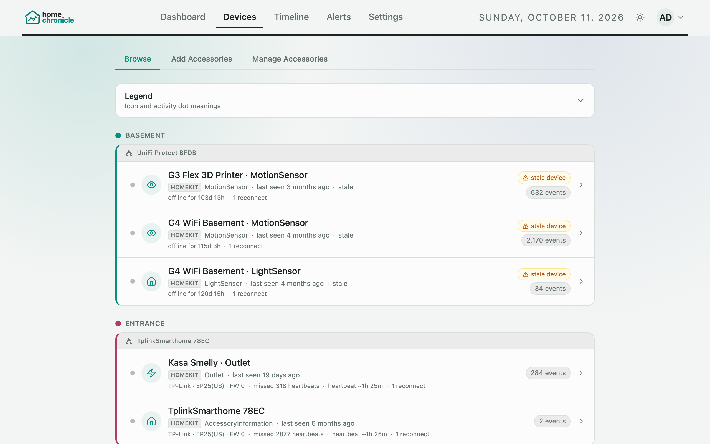
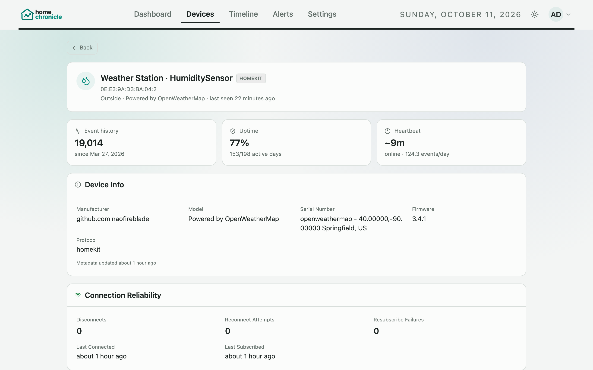

# Device Setup

homechronicle supports two protocols: **HomeKit** (HAP) and **Matter**. Everything about your devices lives on the **Devices** page, which has three tabs:

| Tab | Use it to |
|-----|-----------|
| **Browse** | See every device grouped by room, with its status, and open a device's detail page |
| **Add Accessories** | Scan for and pair HomeKit accessories, and commission Matter accessories |
| **Manage Accessories** | Rename devices, assign rooms, add notes, choose live-toast devices, and repair pairings |

## Browsing devices



**Browse** groups your devices into one table per room, each marked with the room's colour. Devices without a room are listed last under **No room**. Each row shows the device's status, how many events it has logged, and its heartbeat — when a device goes offline or stale, the row says for how long and how many heartbeats it has missed. Open **Legend** for what the icons and activity dots mean.

Select a device to open its detail page.

### Device detail



The detail page shows, where the device has the data:

- **Category** — under the device name; see [Device categories](#device-categories)
- **Device Info** — manufacturer, model, serial number, firmware and hardware revision, protocol and transport
- **Connection Reliability** — disconnects, reconnect attempts, subscribe failures, last connected/subscribed, last error
- **Anomalies (last 24h)** — unusual activity compared with the device's baseline
- **Activity Over Time** — event counts over a range you choose
- **Current State**, **State Duration**, **Activity Heatmap** and **Characteristic Summary**
- **Firmware History** — only shown once a firmware change has been seen (see [Firmware tracking](#firmware-tracking))
- **Full History** — every event for the device, page by page

## HomeKit Devices

### Discovery

**From the web UI:**

1. Go to **Devices › Add Accessories**
2. Click **Scan Network** in the HomeKit section
3. Wait about 10 seconds for mDNS discovery to finish
4. Accessories found on your network appear in the list

**From the CLI:**

```bash
docker compose run --rm listener node src/discover.js
```

Set a specific network interface if needed:

```bash
DISCOVER_IFACE=en0 docker compose run --rm listener node src/discover.js
```

The scan output shows each accessory's name, device ID (for example `AA:BB:CC:DD:EE:FF`), address, port, and pairing status.

### Pairing

**From the web UI:**

1. After scanning, enter the 8-digit PIN (format `111-22-333`) for an accessory and click **Pair**. You can also enter a shared PIN once for several accessories.
2. The listener starts subscribing to events straight away.

The PIN is saved so that [scheduled repair](#scheduled-repair) can re-pair the device later if its pairing breaks.

**From the CLI:**

```bash
docker compose run --rm listener node src/pairing.js <device-id> <pin>
```

After CLI pairing, restart the listener so it starts subscribing:

```bash
docker compose restart listener
```

> **Important:** Pair-setup only works on devices that are not already paired to another controller. Devices that are paired elsewhere are marked **paired elsewhere** after a scan. If a device is already in Apple Home, see [Multiple Controllers](#multiple-controllers-homekit) below.

### Multiple Controllers (HomeKit)

The HomeKit protocol only allows **one pair-setup** per device. Once a device is paired to Apple Home (or any controller), additional controllers must be registered with the **add-pairing** mechanism. There are three approaches:

#### Option 1: Enable Homebridge Insecure Mode (recommended for Homebridge users)

Homebridge's insecure mode (`-I` flag) bypasses the pair-setup restriction, so several controllers can pair independently.

1. Open the Homebridge web UI
2. Go to **Settings** (gear icon, top right)
3. Enable **Enable UI Accessory Control –I**
4. Restart Homebridge

With insecure mode enabled, you can pair devices with both Apple Home and HomeChronicle using the normal pair-setup flow, in either order.

> **Note:** This setting only affects Homebridge accessories. Native HomeKit devices (for example TP-Link plugs or Ecobee thermostats) don't have this option.

#### Option 2: Add as Controller (add-pairing)

If another HomeChronicle instance is already paired to the devices (for example a production instance), you can register this instance as an additional controller.

**From the web UI:**

1. Go to **Devices › Add Accessories**
2. If devices show the amber **paired elsewhere** warning, expand **Add as Controller (advanced)**
3. Paste the contents of the other instance's `pairings.json` file
4. Click **Add as Controller**

**From the CLI:**

```bash
npm run add-pairing -- --source /path/to/source/pairings.json --target /path/to/target/pairings.json
```

The source instance must have admin-level pairings to the target devices. The command registers the target instance's identity on each device and writes the resulting pairing records to the target file.

#### Option 3: Put native devices behind Homebridge

A native HomeKit device (for example a TP-Link Kasa plug) accepts only one controller and has no insecure mode. Pairing it to HomeChronicle would lock Apple Home out, so to keep it in Apple Home **and** log it in HomeChronicle, run it through Homebridge instead:

1. Remove the device from Apple Home (long-press it, open its settings, **Remove Accessory**), so it doesn't show up twice
2. In Homebridge, install a plugin that controls the device on your local network (search **Plugins** for the brand, e.g. "Kasa")
3. Run the plugin on the main bridge, not as a child bridge. A child bridge is a separate HomeKit accessory that you'd have to pair with Apple Home and HomeChronicle separately
4. Restart Homebridge. The device appears in Apple Home under the bridge. The listener reconnects when the bridge comes back and picks up the new device on its own, so it appears under the bridge in **Devices › Manage Accessories**
5. If it isn't there after a minute, restart the listener

This needs the bridge to be paired with both Apple Home and HomeChronicle already (Option 1).

> Scenes and automations that used the device directly need to be set up again with the Homebridge version.

### Bridges (Homebridge, etc.)

When you pair a bridge, homechronicle automatically discovers and subscribes to every accessory behind it. Bridge children are listed under the bridge in **Devices › Manage Accessories**, or via:

```
GET /api/setup/bridge-children/:deviceId
```

If a bridge is unreachable (for example after its IP address changed), Devices still loads with what's cached and the bridge is retried in the background.

## Managing devices

**Devices › Manage Accessories** lists every paired HomeKit and Matter device. For each one you can:

| Field / button | What it does |
|----------------|--------------|
| **Name** (pencil icon) | Set a display name in place of the name the device reports |
| **Room** | Assign a room — HomeKit and Matter don't share room names with homechronicle, so you set them here |
| **Note** | Free-text note shown on the device detail page (PIN, firmware, location, …) |
| **Bell** | Choose whether this device triggers [live event toasts](settings.md#toast) |
| **Repair** (wrench icon) | Re-pair a HomeKit device whose pairing has broken |

Each HomeKit device shows a status badge — **Logging**, **Stale**, or **Needs Repair**. **Repair All** at the top repairs every HomeKit device in one go; any it skips are listed so you can repair them one at a time. Changes to names, rooms and notes save as you type, and a reminder at the top says how many devices still have no room.

### Room assignment

**From the API:**

```bash
curl -X PATCH http://localhost:3001/api/setup/room \
  -H "Content-Type: application/json" \
  -H "X-API-Token: <token>" \
  -d '{"accessoryId": "<id>", "roomName": "Living Room"}'
```

Room assignments are stored in `listener/data/rooms.json`. Each room gets a colour from your palette — see [Appearance](appearance.md#room-colours).

### Device notes

**From the API:**

```bash
curl -X PATCH http://localhost:3001/api/setup/note \
  -H "Content-Type: application/json" \
  -H "X-API-Token: <token>" \
  -d '{"accessoryId": "<id>", "note": "PIN: 111-22-333, mounted above garage door"}'
```

To clear a note, send an empty string or `null` for `note`. Notes are stored in `listener/data/notes.json`.

### Device categories

Each device belongs to one category, used by the **Device Categories** dashboard panel:

| Category | Picked automatically for |
|----------|--------------------------|
| **Security** | Motion, occupancy and contact sensors, security systems, cameras, doorbells |
| **Safety** | Smoke, carbon monoxide and leak sensors |
| **Doors & locks** | Locks, garage doors, doors, windows and blinds |
| **Climate** | Thermostats, heaters and coolers, fans, air purifiers, temperature, humidity, air-quality and light sensors |
| **Lighting** | Lightbulbs, and Matter devices with dimming or colour |
| **Switches & outlets** | Switches, outlets and plugs, valves and sprinklers, TVs |
| **Cleaning** | Nothing — choose it yourself, for example for a robot vacuum that shows up as a switch |
| **Other** | Anything else |

The category comes from everything the device reports, so a motion sensor's battery readings don't make it **Other**, and a Matter light that also reports on/off counts as **Lighting**, not a switch. When a device does several things, the first match in the table wins.

To change it, open the device's detail page and pick a **Category** under its name. **Automatic** (the first option) shows what it would be on its own and goes back to it. The choice applies to every event from that device. Overrides are stored in `listener/data/categories.json`; deleting a device's data or removing a Matter pairing clears its override.

**From the API:**

```bash
curl -X PATCH http://localhost:3001/api/setup/category \
  -H "Content-Type: application/json" \
  -H "X-API-Token: <token>" \
  -d '{"accessoryId": "<id>", "category": "cleaning"}'
```

Send an empty `category` to go back to automatic.

## Matter Devices

Matter support is built into the listener image.

### Commissioning

**From the web UI:**

1. Go to **Devices › Add Accessories** and find the **Matter** section
2. Click **Scan Network** to find accessories in commissioning mode
3. Enter a name and the setup code, then click **Pair**

To add a device that's already in Apple Home, open it in the Home app, tap the gear icon, and choose **Turn On Pairing Mode** — Apple Home shows a setup code to enter here. **How do I pair a Matter accessory?** in the Matter section explains this and where else to find setup codes. If the scan doesn't find your device, use **Add manually…** to enter a setup code (or import by node ID) without scanning.

Commissioning can take a few minutes; the web proxy allows up to 5 minutes for it.

**From the API:**

```bash
curl -X POST http://localhost:3001/api/setup/matter/pair \
  -H "Content-Type: application/json" \
  -H "X-API-Token: <token>" \
  -d '{"name": "My Device", "setupCode": "<code>"}'
```

### How Matter devices report changes

By default the listener keeps a **subscription** open to each Matter device, so a change is reported the moment it happens. As a safety net, it also re-reads every device every 5 minutes, so a subscription that quietly stops causes delayed events rather than missing ones. If a subscription drops, it is restarted with a back-off that starts at 2 seconds and doubles up to 5 minutes.

If you'd rather poll devices on a fixed interval instead (the behaviour before 0.4), turn subscriptions off:

| Variable | Default | Description |
|----------|---------|-------------|
| `MATTER_SUBSCRIBE_ENABLED` | `true` | Use native subscriptions. Set `false` to poll instead. |
| `MATTER_RECONCILE_INTERVAL_MS` | `300000` (5 min) | How often subscribed devices are re-read as a safety net. Values below 30000 use 30000. |
| `MATTER_POLL_INTERVAL_MS` | `5000` | Poll interval, used only when subscriptions are off. Values below 1000 use 30000. |
| `MATTER_SUBSCRIBE_RESTART_DELAY_MS` | `2000` | Starting delay before a dropped subscription is restarted |

A device that stops answering is never given up on. After 10 errors in a row, the listener reads it less and less often (up to every 10 minutes) and keeps retrying, so it recovers on its own when it comes back.

To see which mode is active and the state of each device, call `GET /api/setup/matter/runtime` — it reports `mode` (`subscribe+reconcile` or `poll`) and, per node, whether its subscription is active and when it was last read. See the [API Reference](api-reference.md).

### Supported Matter clusters

Matter readings use the same names and units as HomeKit — for example a temperature of 23.5 °C rather than the raw `2350`, and brightness as a percentage — so Timeline headlines, filters and alert rules work the same for both.

| Cluster | Examples |
|---------|----------|
| On/Off | Smart plugs, switches, lights |
| Level Control | Dimmers (brightness %) |
| Boolean State | Contact sensors, door/window sensors |
| Temperature Measurement | Temperature sensors |
| Relative Humidity Measurement | Humidity sensors |
| Occupancy Sensing | Motion/occupancy sensors |
| Color Control | Hue, saturation, colour temperature |
| Door Lock | Smart locks |
| Window Covering | Blinds and shades (position) |
| Fan Control | Fans (on/off, speed) |
| Thermostat | Current temperature, heating/cooling mode |
| Pressure Measurement | Barometric pressure sensors |
| Illuminance Measurement | Light-level sensors |
| Electrical Power Measurement | Energy-monitoring plugs |
| Smoke/CO Alarm | Smoke detected, carbon monoxide detected, low battery |

Devices that only use other clusters will pair but won't produce events.

## Scheduled Repair

The listener can repair broken HomeKit pairings automatically once a day. When enabled, it looks for devices with reconnection errors or that haven't been seen recently, then re-discovers and re-subscribes to each one. Devices whose stored keys were rejected are fully re-paired using the saved PIN; devices without a saved PIN are skipped with a warning.

**From the web UI:** go to **Settings › Configuration › Device Management**, turn on **Scheduled Repair**, and choose the **Repair Hour** (shown in your local time).

**From the API:**

```bash
curl -X PATCH http://localhost:3001/api/setup/repair \
  -H "Content-Type: application/json" \
  -H "X-API-Token: <token>" \
  -d '{"enabled": true, "hour": 3}'
```

Over the API, `hour` is a UTC hour, whatever time zone the container runs in. Settings are stored in `listener/data/repair.json`.

## Firmware tracking

The listener detects firmware version changes on HomeKit accessories. When a device reconnects and reports a different `FirmwareRevision` from the one cached, the listener logs a `FirmwareRevision` event with the old and new version. It appears in the Timeline like any other change, and in the **Firmware History** section of the device's detail page.

## Event subscriptions (HomeKit)

Once paired, the listener keeps a persistent connection to every HomeKit accessory. For each state change (light on/off, temperature reading, motion detected, and so on) it:

1. Receives the HAP event
2. Records the previous value from its in-memory cache
3. Inserts a row into the `event_logs` table
4. Checks your [alert rules](alerts.md)
5. Updates the value cache

### Reconnection

If a device becomes unreachable, the listener reconnects with exponential back-off:

- Initial delay: 5 seconds (`RECONNECT_BASE_MS`)
- Maximum delay: 60 seconds (`RECONNECT_MAX_MS`)

Every HomeKit request has a timeout (`HAP_REQUEST_TIMEOUT_MS`, default 30 seconds; pairing uses `HAP_PAIR_TIMEOUT_MS`, default 60 seconds), so a device that accepts a connection but never answers is dropped and reconnected rather than left hanging.

### Background discovery

By default the listener runs a background mDNS scan every hour to find new devices and update the IP addresses of existing pairings. Turn it off in **Settings › Configuration › Device Management** (**HomeKit auto-scan**), or with:

```
DISCOVERY_SCAN_ENABLED=false
```

## Unpairing

**From the web UI:** go to **Settings › Configuration › Advanced**, open the **Danger Zone**, and use **Remove pairings** (admins only). See [Settings](settings.md#danger-zone).

**From the API:**

```bash
curl -X DELETE http://localhost:3001/api/setup/pairing/<deviceId> \
  -H "X-API-Token: <token>"
```

This removes the pairing keys and stops the subscription. The device's event history is kept.
