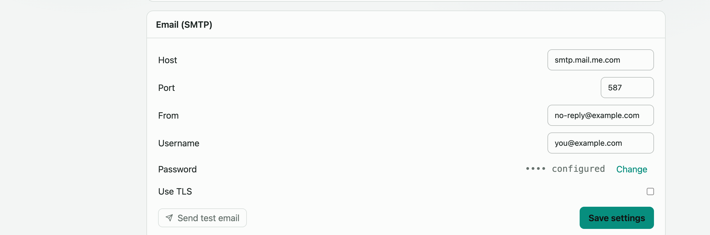

# Email (SMTP)

Email is **optional**. If `SMTP_HOST` or `SMTP_PASS` is not set, email features are disabled and the listener boots normally — no error, no failed startup.

## Environment Variables

| Variable | Default | Description |
|----------|---------|-------------|
| `SMTP_HOST` | — | SMTP server hostname (e.g. `smtp.fastmail.com`, `smtp.gmail.com`) |
| `SMTP_PORT` | `587` | Port — `587` for STARTTLS (default) or `465` for implicit TLS |
| `SMTP_USER` | — | SMTP account username (usually your email address or login name) |
| `SMTP_PASS` | — | SMTP password or app-password. Stored in `smtp-secret.json` (0600 permissions); never returned by any API response. This env var overrides the stored secret. |
| `SMTP_FROM` | — | From header for outbound emails (e.g. `HomeChronicle <noreply@yourdomain>`) |
| `SMTP_SECURE` | `false` | Set `true` only when using port 465 (implicit TLS). Leave unset or `false` for port 587 STARTTLS. |
| `APP_BASE_URL` | — | Public base URL of this instance — used to build invite and password-reset links. Must include scheme and host, no trailing slash. Example: `https://home.example.net` |

## Configuration

SMTP can be configured two ways:

1. **Environment variables** — set in `.env` (or Docker environment). Takes effect on next container restart.
2. **Settings UI** — go to **Settings > Admin > Email (SMTP)** (admin-only). Changes apply immediately without a restart.

Environment variable values override any settings saved through the UI.

## What Email Is Used For

| Feature | Requires |
|---------|---------|
| User invitations (invite link doubles as email verification) | SMTP + `APP_BASE_URL` |
| Password reset links | SMTP + `APP_BASE_URL` |
| Email alert channel | SMTP + `ALERTS_ENABLED=true` |

For email alerts, see [Settings](settings.md#alerts).

## Port & TLS Quick Reference

| Port | Protocol | `SMTP_SECURE` |
|------|----------|---------------|
| `587` | STARTTLS (upgrades to TLS after connect) | `false` (default) |
| `465` | Implicit TLS (TLS from the first byte) | `true` |

Most modern email providers use port 587 STARTTLS. Use port 465 only if your provider explicitly requires it.

## Testing the Connection

After configuring SMTP (via env or UI), use the **Send test email** button in **Settings > Admin > Email (SMTP)** to verify delivery. The test sends a message to the admin's account email.
