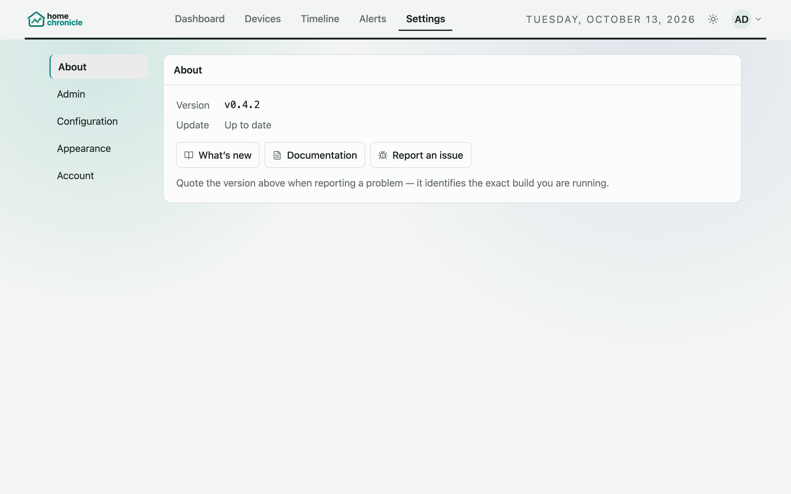
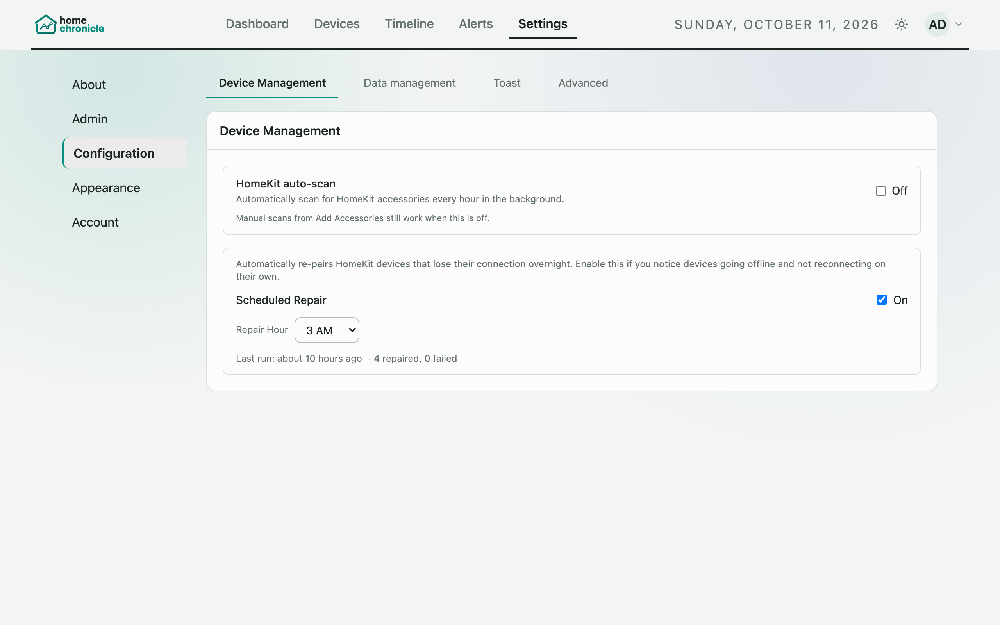
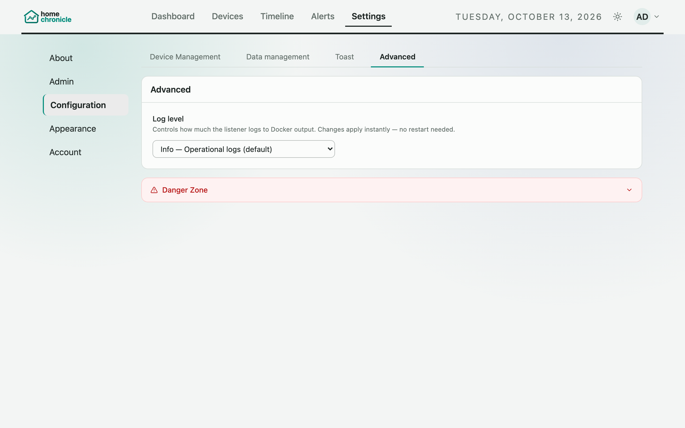

# Settings

Open **Settings** from the top navigation bar (or the floating navigation button on phones and tablets). Settings is split into up to five sections, listed down the left side on wider screens and in a drop-down menu on phones:

| Section | Shown | Contains |
|---------|-------|----------|
| **About** | Always | Version, update status, changelog, help links |
| **Admin** | Login enabled, admins only | Users, Pending invites, Email (SMTP) |
| **Configuration** | Always (opens by default) | Device Management, Data management, Toast, and Advanced tabs |
| **Appearance** | Always | Theme, palette and temperature unit |
| **Account** | Login enabled | Change password, Active Sessions |

All settings save automatically unless noted otherwise.

## About

| Item | Description |
|------|-------------|
| **Version** | The version of the web UI you're running |
| **Update** | **Up to date**, a link such as **v0.4.1 available** that opens the release notes, **Couldn't check for updates** if the check failed, or **Update check is off** |
| **What's new** | Opens the changelog. A dot appears after an upgrade until you've read the new notes (the changelog also opens by itself the first time you load a new version). |
| **Documentation** | Opens this guide |
| **Report an issue** | Opens the project's issue tracker on GitHub |

On desktop, a dot on **Settings** in the navigation bar means there are changelog notes you haven't read, and an "*version* available" link appears in the top bar when an update is out.

### Update check

The listener checks the project's releases on GitHub and GitLab (`GET /api/updates/latest`), and caches the answer for 12 hours. Your browser only talks to your own HomeChronicle server — it never contacts GitHub, GitLab or any other site directly.

- Stable versions only offer stable updates. If you run a beta, newer betas are offered too.
- If the listener can't reach either GitHub or GitLab, About shows **Couldn't check for updates** rather than claiming you're up to date.
- To turn the check off for everyone, set `UPDATE_CHECK_ENABLED=false` on the listener (see [Environment Variables](environment-variables.md)).
- To turn it off in one browser only, run `localStorage.setItem('hc_disable_update_check', 'true')` in the browser console.

## Admin (login enabled, admins only)

### Users and Pending invites

Invite members, change roles (admin/member), and disable accounts. Invitations waiting to be accepted are listed under **Pending invites**, where you can resend or revoke them. A last-admin guard stops you demoting or disabling the only admin. Invites need [Email (SMTP)](email.md) configured. See [Accounts & Users](accounts.md).

### Email (SMTP)

SMTP settings for outgoing email: host, port, username/password, From address, TLS, and a test-email button. Any field set by an environment variable (`SMTP_HOST` and so on) is shown as "Set via environment variable" and can't be changed here. See [Email (SMTP)](email.md).

## Configuration

Configuration has three tabs for everyone — **Device Management**, **Data management** and **Toast** — plus an **Advanced** tab for admins (or for everyone when login is disabled).

Household-wide settings (auto-scan, scheduled repair, retention, alert defaults) need an admin to change them when login is enabled. Personal settings (quiet hours, Timeline grouping, toasts) are saved per user.

### Device Management

#### HomeKit auto-scan

Scans for HomeKit accessories on your network every hour in the background. Manual scans from **Devices › Add Accessories** still work when this is off.

#### Scheduled Repair

Automatically re-pairs HomeKit devices that lose their connection overnight. When enabled, the listener looks for devices with reconnection errors or that haven't been seen recently, and re-discovers and re-subscribes to them. Devices with a saved PIN are fully re-paired.

| Setting | Description |
|---------|-------------|
| **Scheduled Repair** | Turns the daily repair on or off |
| **Repair Hour** | Hour of day to run the repair, shown in your local time |

The last run time and result (repaired/failed counts) are shown underneath. See also [Device Setup](devices.md#scheduled-repair).

### Data management

The Data management tab has three cards.

#### Data Management

| Setting | Description |
|---------|-------------|
| **Retention cutoff** | How many days to keep events in the main `event_logs` table. Older events are removed by the daily retention sweep. Changes apply without a restart. |
| **Archive before delete** | When on, expired events are copied to `event_logs_archive` before removal. When off, they are permanently deleted. If archive data exists, a download button lets you export it. |
| **Stale accessory threshold** | Hours without events before an accessory is marked "stale" on the dashboard and device list |

#### Alerts & Quiet Hours

| Setting | Description |
|---------|-------------|
| **Default quiet period** | The quiet period new alert rules start with (0–10080 minutes). The rule form fills it in, and a rule created over the API without `quietMinutes` gets it too. Existing rules keep their own value. |
| **Webhook timeout** | How long a webhook delivery waits for a response (1000–30000 ms, default 5000). If `ALERTS_WEBHOOK_TIMEOUT_MS` is set on the listener, that value is used instead and the field is locked. |
| **Quiet hours** | On/off, plus a **From**/**to** window in your local time. Activity in this window is flagged on the dashboard. Accessories you've excluded (from the dashboard's Quiet Hours panel) appear as badges here; click one to include it again. |

Alert rules themselves are managed on the [Alerts](alerts.md) page.

When you're signed in, quiet hours are saved per user and follow you across devices. With login disabled, one shared household setting is used.

#### Timeline

These settings control how the [Timeline](timeline.md#scenes-and-episodes) groups events.

| Setting | Default | Range | Description |
|---------|---------|-------|-------------|
| **Episode capture interval** | 3 min | 1–30 min | Scenes that start within this window of each other can be grouped into an episode |
| **Scene grouping window** | 5 sec | 1–30 sec | Events within this many seconds of each other form one scene |
| **Episode minimum events** | 3 | 1–20 | A group needs at least this many events to become an episode |

### Toast

| Setting | Description |
|---------|-------------|
| **Toast notifications** | Brief pop-up messages for saves, deletes and other actions. When off, the other toast settings are greyed out. |
| **Live event toasts** | A pop-up when chosen accessories change state (for example, a light turning on). Not shown while you're on the Timeline, which already shows the event. |
| **Toast position** | Bottom Right (default), Bottom Left, Bottom Center, Top Right, Top Left, or Top Center |
| **Toast duration** | 2, 3 (default), 5 or 7 seconds |
| **Max visible toasts** | 1, 2, 3 (default) or 5 |

To choose which accessories trigger live toasts, go to **Devices › Manage Accessories** and click the bell icon next to each device. HomeKit and Matter devices are both supported.

### Advanced

Shown to admins, or to everyone when login is disabled.

#### Log level

Controls how much the listener writes to its Docker logs. Changes apply instantly, without a restart.

| Level | Description |
|-------|-------------|
| **Error** | Errors only |
| **Warn** | Errors and warnings |
| **Info** | Normal operation (default) |
| **Debug** | Verbose output for troubleshooting |

#### Danger Zone

A collapsible section for destructive actions. Each one asks for confirmation.

- **Remove pairings** — unpair individual HomeKit or Matter accessories. Event history is **not** deleted; only the pairing keys are removed and the subscription stops. **Remove All Pairings** (shown when several devices are paired) asks you to type `DELETE`.
- **Delete accessory data** — delete stored event history for individual accessories. Filter by all accessories, currently paired, or no longer paired. Deleting history does not unpair the device.
- **Wipe All Data** — permanently deletes all event data. Asks you to type `DELETE`. This can't be undone.

## Appearance

Theme (Light / Dark / System), palette and temperature unit (°C / °F). See [Appearance](appearance.md).

## Account (login enabled)

### Change password

Update your password. You need to enter your current password.

### Active Sessions

Lists your signed-in sessions with the browser/device and IP address recorded at login. You can revoke any of them, including the one you're using; a revoked session stops working immediately. See [Accounts & Users](accounts.md#active-sessions).

## Per-user preferences

When you're signed in, these are saved to your account and follow you to any browser or device:

- Theme, palette and temperature unit
- Dashboard layout, panel sizes, hidden panels, date ranges and the Sync toggle
- Muted devices on the Timeline
- Toast settings
- Timeline grouping settings
- Quiet-hours settings

A change made just before you sign out or close the tab is still saved. Signing out removes these preferences from that browser.

With login disabled, preferences are stored in each browser's `localStorage` and aren't synced.
