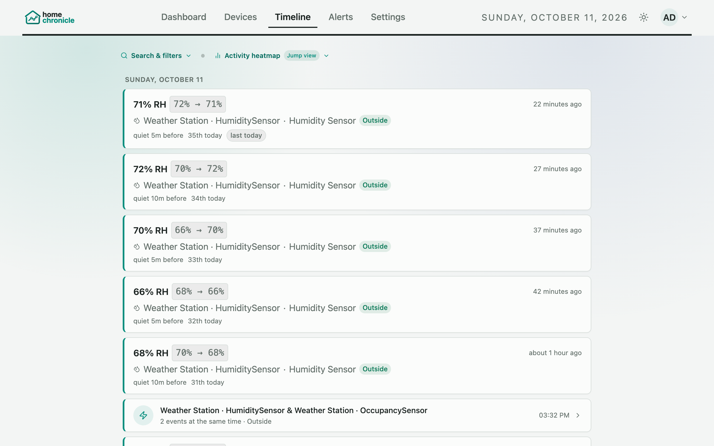
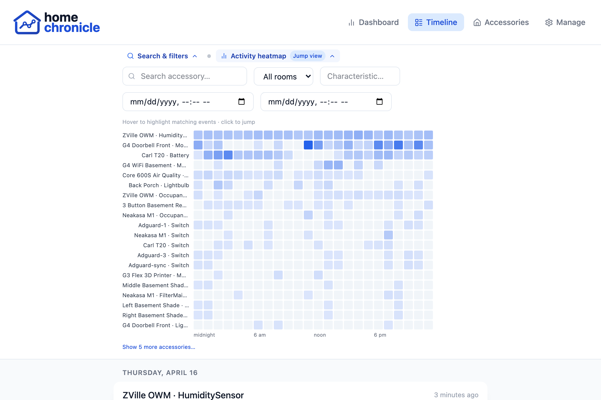

# Timeline

The **Timeline** is the full event log: every change your devices report, newest first, grouped by day.

## Reading an entry

Each entry leads with **what happened**, in plain words — "motion detected", "60% RH", a light turning on — with the device and its room underneath, and how long ago it happened on the right. HomeKit and Matter devices read the same way.

Some entries carry an extra line with context:

| Note | Meaning |
|------|---------|
| **first today** / **last today** / **only event today** | This device's first, last, or only event of the day |
| **3rd today** (and so on) | Where this event falls among the device's events that day |
| **quiet 4h 12m before** | Time since this device's previous event that day (shown for gaps of 2 minutes or more) |
| **⚠ device spike vs baseline** / **room spike vs baseline** | The device or room is unusually busy at this hour compared with its normal pattern |

Select a device name to open its detail page.

When quiet hours are on, a divider marked **quiet hours** with the window (for example "11 PM – 6 AM") separates the quiet-hours stretch of each day from the rest.

## Scenes and episodes

Events that happen close together are grouped so a busy moment doesn't flood the list.

- **Scene** — events within a few seconds of each other (default 5 seconds), such as several lights changing together. A scene shows as one row, "*N* events at the same time"; select it to see the individual events.
- **Episode** — scenes that follow each other within a few minutes (default 3 minutes), with at least 3 events (by default) from more than one burst or more than one device. An episode card shows "*N* events across *M* bursts" and the rooms involved; expand it to see the scenes inside.

Episodes are given a title from what happened in them:

| Title | When |
|-------|------|
| **Arrival activity** | A door or entry opened, followed by motion, occupancy, or lights turning on |
| **Departure activity** | Doors or locks closed while lights turned off |
| **Bedtime wind-down** | Several lights off, or a security system change, together with a lock being secured |
| ***Room* activity** | Everything happened in one room |
| **Home activity episode** | Anything else |

You can change the grouping windows in **Settings › Configuration › Data management › Timeline**:

| Setting | Default | Range |
|---------|---------|-------|
| Episode capture interval | 3 min | 1–30 min |
| Scene grouping window | 5 sec | 1–30 sec |
| Episode minimum events | 3 | 1–20 |

When you're signed in, these settings are saved per user.

## Search & filters

Click **Search & filters** above the list to open the filter bar. The button shows how many filters are active.

| Filter | Matches |
|--------|---------|
| **Search accessory…** | Device name |
| **All rooms** | One room (the room's colour is shown beside the menu) |
| **Characteristic…** | Characteristic name, such as `MotionDetected` or `CurrentTemperature` |
| **From** / **To** | A date and time range |

**Clear filters** removes them all. Opening the Timeline from the dashboard — for example by selecting a room on **Where Things Happen**, or an event in **Live Activity** — fills in the matching filter for you.

### Exporting events

**Export: CSV** or **JSON** in the filter bar downloads every event that matches the current filters — all pages, not just the ones on screen — oldest first. With no filters it exports the whole event log. Muted devices are included; the export follows the filters, not what's hidden on screen. Rooms reflect your current room assignments, as in the list.

The CSV opens in Excel, Numbers or Google Sheets. Text that starts with `=`, `+`, `-` or `@` (a device name, say) is prefixed with a `'` so a spreadsheet doesn't treat it as a formula; plain numbers such as `-18.5` are left as numbers. Exports stop at 500,000 events (`EVENTS_MAX_EXPORT_ROWS`); if a filter matches more, the bar says how many were exported. Narrow the **From** / **To** range to get the rest. Older, archived events are exported separately from **Settings › Configuration › Data management**.

## Activity heatmap

Click **Activity heatmap** to show a grid of the last 7 days: one row per device, one column per hour of the day, darker for more events. Hour columns are in your local time.

- **Hover** over a cell to highlight that device's events at that hour in the list.
- **Click** a cell to jump to the most recent matching event — the Timeline moves to the right page and scrolls to it. Click the same cell again (or **clear**) to release the highlight.

## Muting devices

Hover over an entry and click the mute icon to hide that device from the Timeline. Muted devices are listed above the list; click the **×** on one to unmute it. When you're signed in, your muted devices are saved to your account.

## Live updates and paging

The Timeline shows 50 events per page, with **Previous** and **Next** at the bottom. The first page refreshes every 10 seconds, so new events appear on their own; other pages stay put while you read them.

To get a pop-up for new events while you're elsewhere in the app, turn on [live event toasts](settings.md#toast).
